# Clips to watch

All three C06 runs get these wrong. There are 132 such clips in grouped val; these are 20 of them, most confident mistake first within each group: 8 Pull, 6 Late Cut, 6 others.

In each picture the top row is the original video and the bottom row is the crop the model saw. Click the clip's name to open the video. Note what you find in `review.csv`.

## 1. Pull: C06 says Down The Wicket

[Pull/vid445_27.avi](../../data/CricShoot10kShootDataset/Pull/vid445_27.avi), 24 frames. C06 gives Down The Wicket 100% and Pull 0%.

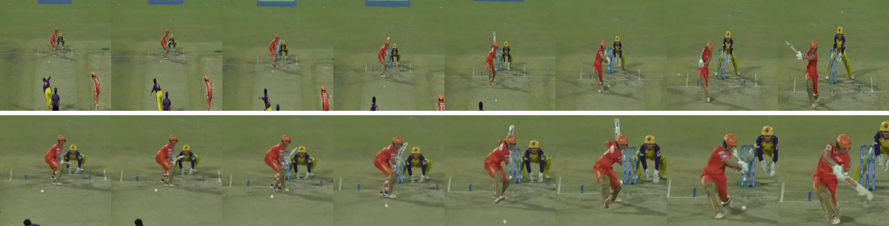

## 2. Pull: C06 says Hook

[Pull/vid102_29.avi](../../data/CricShoot10kShootDataset/Pull/vid102_29.avi), 24 frames. C06 gives Hook 100% and Pull 0%.

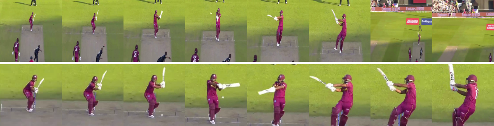

## 3. Pull: C06 says Hook

[Pull/vid160_34.avi](../../data/CricShoot10kShootDataset/Pull/vid160_34.avi), 24 frames. C06 gives Hook 100% and Pull 0%.

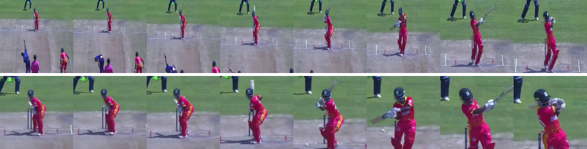

## 4. Pull: C06 says Hook

[Pull/vid387_17.avi](../../data/CricShoot10kShootDataset/Pull/vid387_17.avi), 49 frames. C06 gives Hook 100% and Pull 0%.

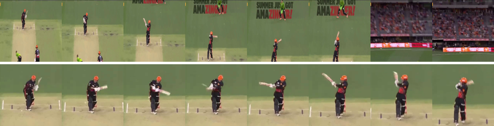

## 5. Pull: C06 says Sweep

[Pull/vid459_26.avi](../../data/CricShoot10kShootDataset/Pull/vid459_26.avi), 24 frames. C06 gives Sweep 100% and Pull 0%.

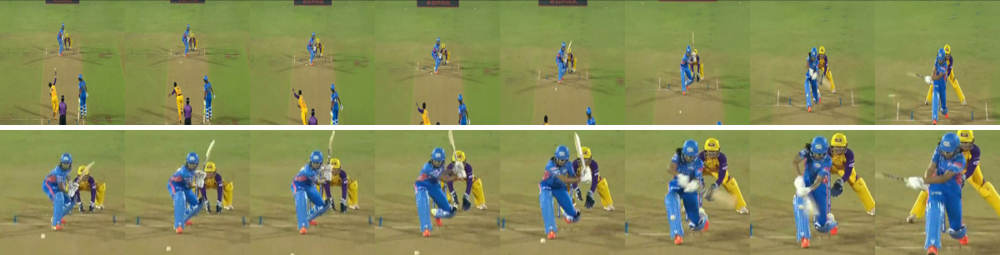

## 6. Pull: C06 says Hook

[Pull/vid527_23.avi](../../data/CricShoot10kShootDataset/Pull/vid527_23.avi), 28 frames. C06 gives Hook 100% and Pull 0%.

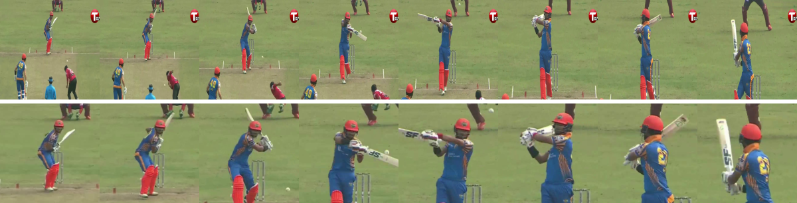

## 7. Pull: C06 says Hook

[Pull/vid527_64.avi](../../data/CricShoot10kShootDataset/Pull/vid527_64.avi), 28 frames. C06 gives Hook 99% and Pull 1%.

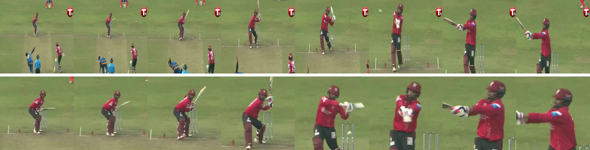

## 8. Pull: C06 says Hook

[Pull/vid387_32.avi](../../data/CricShoot10kShootDataset/Pull/vid387_32.avi), 49 frames. C06 gives Hook 99% and Pull 0%.

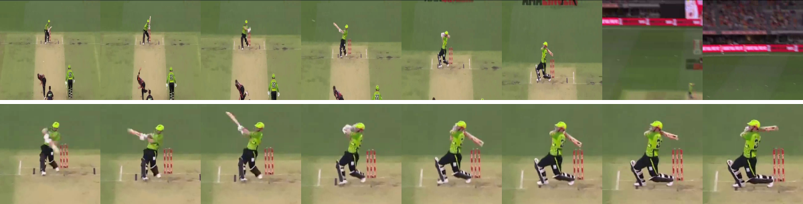

## 9. Late Cut: C06 says Defensive

[Late Cut/vid367_28.avi](../../data/CricShoot10kShootDataset/Late%20Cut/vid367_28.avi), 28 frames. C06 gives Defensive 99% and Late Cut 0%.

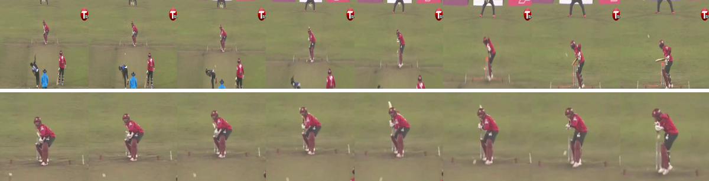

## 10. Late Cut: C06 says Square Cut

[Late Cut/vid127_21.avi](../../data/CricShoot10kShootDataset/Late%20Cut/vid127_21.avi), 24 frames. C06 gives Square Cut 99% and Late Cut 1%.

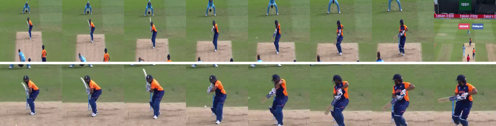

## 11. Late Cut: C06 says Square Cut

[Late Cut/vid363_28.avi](../../data/CricShoot10kShootDataset/Late%20Cut/vid363_28.avi), 24 frames. C06 gives Square Cut 98% and Late Cut 0%.

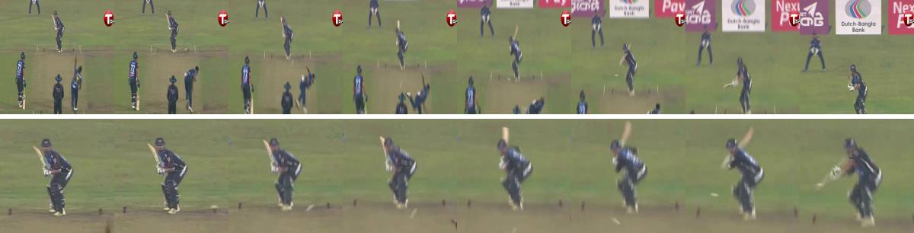

## 12. Late Cut: C06 says Square Cut

[Late Cut/vid126_36.avi](../../data/CricShoot10kShootDataset/Late%20Cut/vid126_36.avi), 24 frames. C06 gives Square Cut 97% and Late Cut 3%.

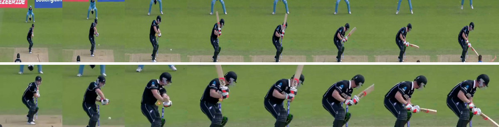

## 13. Late Cut: C06 says Cover Drive

[Late Cut/vid446_49.avi](../../data/CricShoot10kShootDataset/Late%20Cut/vid446_49.avi), 24 frames. C06 gives Cover Drive 97% and Late Cut 3%.

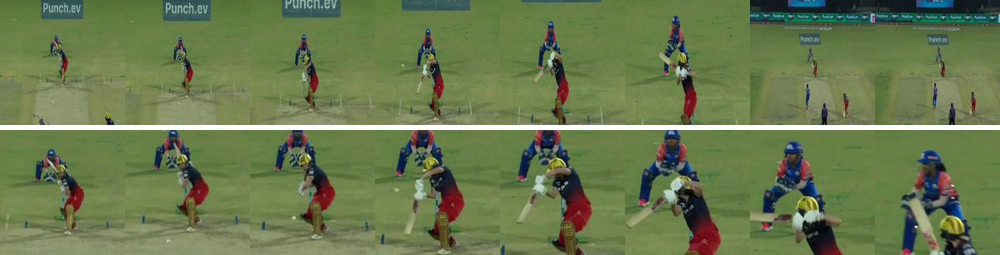

## 14. Late Cut: C06 says Defensive

[Late Cut/vid148_39.avi](../../data/CricShoot10kShootDataset/Late%20Cut/vid148_39.avi), 24 frames. C06 gives Defensive 96% and Late Cut 4%.

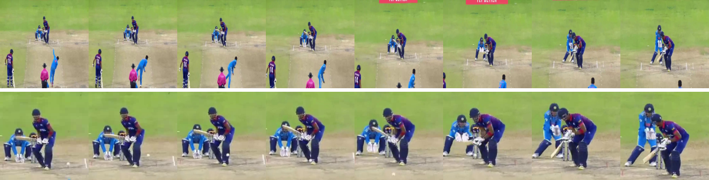

## 15. Lofted Offside: C06 says Down The Wicket

[Lofted Offside/vid513_15.avi](../../data/CricShoot10kShootDataset/Lofted%20Offside/vid513_15.avi), 28 frames. C06 gives Down The Wicket 100% and Lofted Offside 0%.

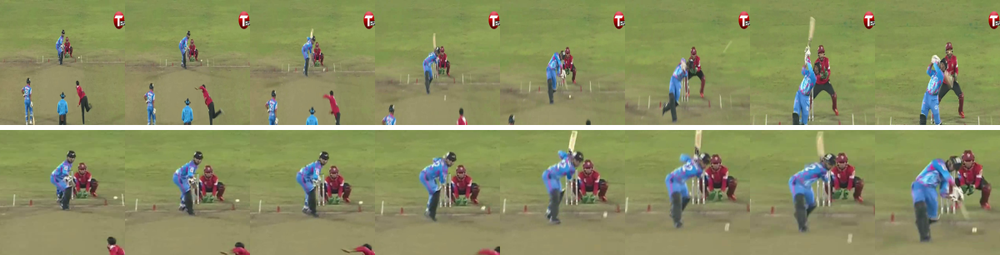

## 16. Upper Cut: C06 says Square Cut

[Upper Cut/vid232_3.avi](../../data/CricShoot10kShootDataset/Upper%20Cut/vid232_3.avi), 24 frames. C06 gives Square Cut 100% and Upper Cut 0%.

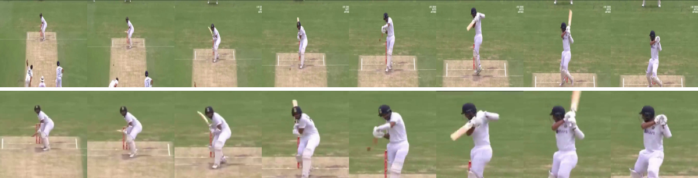

## 17. Cover Drive: C06 says Lofted Offside

[Cover Drive/vid447_18.avi](../../data/CricShoot10kShootDataset/Cover%20Drive/vid447_18.avi), 24 frames. C06 gives Lofted Offside 100% and Cover Drive 0%.

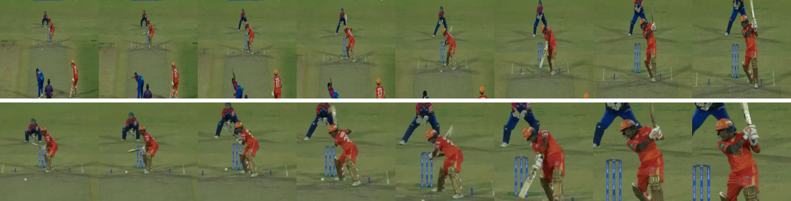

## 18. Down The Wicket: C06 says Lofted Offside

[Down The Wicket/vid445_37.avi](../../data/CricShoot10kShootDataset/Down%20The%20Wicket/vid445_37.avi), 24 frames. C06 gives Lofted Offside 100% and Down The Wicket 0%.

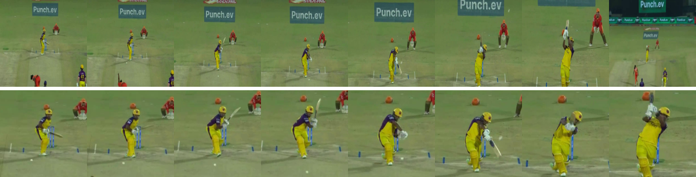

## 19. Lofted Offside: C06 says Down The Wicket

[Lofted Offside/vid367_7.avi](../../data/CricShoot10kShootDataset/Lofted%20Offside/vid367_7.avi), 28 frames. C06 gives Down The Wicket 100% and Lofted Offside 0%.

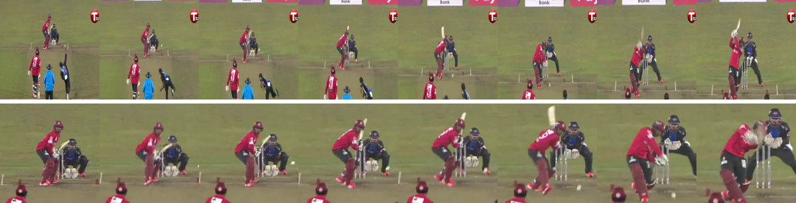

## 20. Square Cut: C06 says Late Cut

[Square Cut/vid110_0.avi](../../data/CricShoot10kShootDataset/Square%20Cut/vid110_0.avi), 24 frames. C06 gives Late Cut 100% and Square Cut 0%.

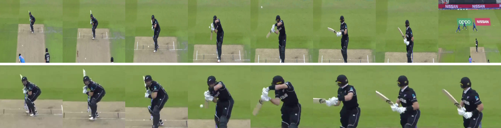
